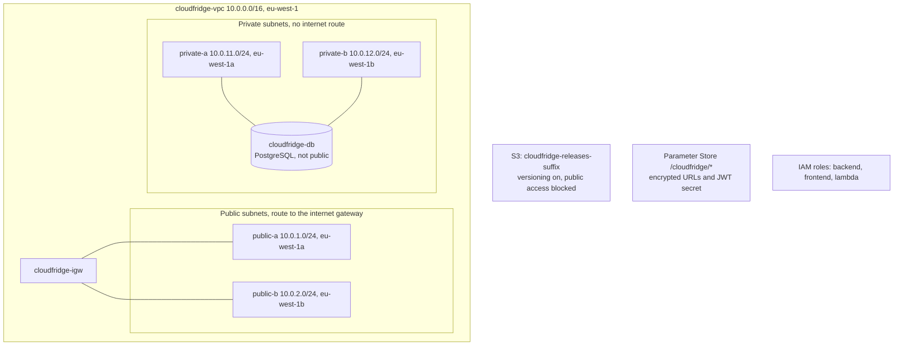

# Phase 2: Foundation Walkthrough

> **Status:** Done ✅ (10 November 2026). RDS is stopped. AWS restarts it automatically on 17 November 2026, so stop it again if Phase 3 hasn't started by then.
> **Region:** `eu-west-1` (Ireland). Check the region selector at the top right of the console before every step.
> **Names and tags:** prefix `cloudfridge-`, tag `Project=cloudfridge` on everything that accepts tags.
> **Screenshots:** 4, marked 📸. Everything else is described in the report's text, so don't stop to capture it.
> **Time:** about 2 hours. RDS takes about 10 minutes to create, so start it (step 5) and do step 6 preparation while it builds.

All steps are done and the resource table is filled in. IDs marked `look up` weren't captured in a screenshot: copy them from the console before Phase 3 (**VPC** console → each resource list).

---

## 1. Objective

Build the AWS network, security groups, roles, releases bucket, private database and secrets. At the end, AWS is ready to receive the app in Phase 3, and the screenshots prove the database can't be reached from the internet.

**Cost:** everything here is free except RDS, about $0.02 per hour while running, plus about $2 a month for 20 GB of storage. Stop it at the end of the session (step 8).

---

## 2. Resource table

Inventory for Phase 3 and for cleanup.

| Resource | Name | ID or endpoint |
| --- | --- | --- |
| Budget | AWS default `My Monthly Cost Budget` ($40). See the note below the table. | — |
| VPC | `cloudfridge` (`10.0.0.0/16`) | `vpc-06619aaa1f0e99d36` |
| Internet gateway | `cloudfridge-igw` | `igw-0562bad216687f574` |
| Subnet | `cloudfridge-public-a` (`10.0.1.0/24`, `eu-west-1a`) | look up |
| Subnet | `cloudfridge-public-b` (`10.0.2.0/24`, `eu-west-1b`) | look up |
| Subnet | `cloudfridge-private-a` (`10.0.11.0/24`, `eu-west-1a`) | `subnet-0007863ece7ced3c4` |
| Subnet | `cloudfridge-private-b` (`10.0.12.0/24`, `eu-west-1b`) | `subnet-0c50d44265cad5a04` |
| Route table | `cloudfridge-public-rt` | look up |
| Route table | `cloudfridge-private-rt` | look up |
| Route table | Default main route table, unused | `rtb-0fdfab15ef0953251` |
| Security group | `cloudfridge-alb-sg` | look up |
| Security group | `cloudfridge-frontend-sg` | look up |
| Security group | `cloudfridge-backend-sg` | `sg-0c30c5d42d16708f0` |
| Security group | `cloudfridge-lambda-sg` | `sg-0f811b646a2579f27` |
| Security group | `cloudfridge-db-sg` | `sg-01e105d0b6f2ba8cd` |
| Security group | `cloudfridge-email-endpoint-sg` | look up |
| IAM role | `cloudfridge-backend-role` | — |
| IAM role | `cloudfridge-frontend-role` | — |
| IAM role | `cloudfridge-lambda-role` | — |
| S3 bucket | `cloudfridge-releases-<suffix>` | look up the suffix |
| DB subnet group | `cloudfridge-db-subnet-group` | — |
| RDS | `cloudfridge-db` (PostgreSQL 17.11, `db.t4g.micro`, 20 GiB, single-AZ, public access No) | `cloudfridge-db.cf686was0jts.eu-west-1.rds.amazonaws.com` (private IP `10.0.11.187`) |
| Parameters | `/cloudfridge/db/admin-url`, `/cloudfridge/db/app-url`, `/cloudfridge/jwt-secret` | SecureString |

**Notes**

- The VPC's Name tag is `cloudfridge`, not `cloudfridge-vpc`. It works the same; in the console, pick it by its ID.
- **Budget:** the account already had `My Monthly Cost Budget` ($40, healthy). Check its **Advanced options** once: **Credits** should be unticked, or the budget reads \$0 until the credits run out. A separate `cloudfridge-monthly-budget` of \$20 is optional.
- **Endpoint spelling:** the hostname contains `was0jts`, not `wes0jts`. A one-letter typo gives `NXDOMAIN`, so always copy it with the copy icon.
- **Cost allocation tag:** `Project` wasn't listed yet on 10 November (AWS needs up to 24 hours). Activate it at the start of Phase 3 (**Billing** → **Cost allocation tags**).


---

## 3. What you're building



---

## 4. Steps

### Step 0: Cost protection

**0.1 Budget**

1. Open **Billing and Cost Management** → **Budgets** → **Create budget**.
2. Choose **Customize (advanced)** → **Cost budget** → **Next**.
3. Name `cloudfridge-monthly-budget`, period **Monthly**, amount `20`.
4. Under **Advanced options**, untick **Credits**. Otherwise the credits cancel out the spending and the budget shows $0 until they run out.
5. **Next** → add an alert at **50%** of actual cost and another at **100%**, both sent to your email.
6. **Create budget**.

**0.2 Cost allocation tag** (needed for the cost screenshot in Phase 6)

1. **Billing and Cost Management** → **Cost allocation tags**.
2. The `Project` tag appears only after a tagged resource exists, so do this at the end of the session: tick `Project` → **Activate**.

---

### Step 1: VPC, subnets and routing

**1.1 VPC**

1. **VPC** console → **Your VPCs** → **Create VPC** → **VPC only**.
2. Name tag `cloudfridge-vpc`, IPv4 CIDR `10.0.0.0/16`, add tag `Project` = `cloudfridge` → **Create VPC**.
3. Select it → **Actions** → **Edit VPC settings** → tick **Enable DNS hostnames** (DNS resolution is already on) → **Save**.

**1.2 Internet gateway**

1. **Internet gateways** → **Create internet gateway** → name `cloudfridge-igw`, tag `Project` → **Create**.
2. **Actions** → **Attach to VPC** → `cloudfridge-vpc` → **Attach**.

**1.3 Subnets**

**Subnets** → **Create subnet** → VPC `cloudfridge-vpc`. Use **Add new subnet** to create all four at once, each with the `Project` tag:

| Name | Availability Zone | CIDR |
| --- | --- | --- |
| `cloudfridge-public-a` | `eu-west-1a` | `10.0.1.0/24` |
| `cloudfridge-public-b` | `eu-west-1b` | `10.0.2.0/24` |
| `cloudfridge-private-a` | `eu-west-1a` | `10.0.11.0/24` |
| `cloudfridge-private-b` | `eu-west-1b` | `10.0.12.0/24` |

Then, for **each public subnet**: select it → **Actions** → **Edit subnet settings** → tick **Enable auto-assign public IPv4 address** → **Save**.

**1.4 Route tables**

1. **Route tables** → **Create route table** → `cloudfridge-public-rt` in `cloudfridge-vpc`.
   - **Routes** → **Edit routes** → **Add route**: `0.0.0.0/0` → **Internet Gateway** → `cloudfridge-igw` → **Save**.
   - **Subnet associations** → **Edit subnet associations** → tick both public subnets → **Save**.
2. **Create route table** → `cloudfridge-private-rt` in `cloudfridge-vpc`.
   - Leave only the `local` route. No internet route.
   - **Subnet associations** → tick both private subnets → **Save**.

📸 `p2-vpc-map.png`: **Your VPCs** → `cloudfridge-vpc` → **Resource map** tab. This is the key VPC image for the slides: 4 subnets, 2 route tables and the internet gateway.

---

### Step 2: Security groups

You need **6 separate security groups** (one firewall per component, not one group with 6 rules). Create all six **empty** first so they all exist when you point rules at each other.

**2.1 Create the 6 empty security groups**

**VPC** (or **EC2**) console → **Security groups** → **Create security group**, and repeat once for each name below:

- **Security group name:** from the list below *(cannot be changed after creation)*
- **Description:** any short note (required by AWS, e.g., `ALB HTTP access`, `Backend API`, etc.)
- **VPC:** `cloudfridge-vpc` (`10.0.0.0/16`)
- **Inbound rules:** leave empty for now
- **Outbound rules:** leave as default (All traffic)
- **Tags:** `Project` = `cloudfridge` (plus `Name` = `<group-name>` if you want it shown in the Name column)

Create these 6 groups:
1. `cloudfridge-alb-sg` (for the Application Load Balancer)
2. `cloudfridge-frontend-sg` (for frontend EC2 instances)
3. `cloudfridge-backend-sg` (for backend EC2 instances)
4. `cloudfridge-lambda-sg` (for the alert Lambda function)
5. `cloudfridge-db-sg` (for the RDS PostgreSQL database)
6. `cloudfridge-email-endpoint-sg` (for the SES SMTP VPC endpoint)

**2.2 Add inbound rules**

Open each security group → **Inbound rules** tab → **Edit inbound rules** → **Add rule**, then **Save rules**:

- For `0.0.0.0/0`: set **Source type** to **Anywhere-IPv4** (or **Custom** and type `0.0.0.0/0`).
- For another security group: keep **Source type** as **Custom**, click inside the **Source** search box, type `cloudfridge-`, and select the matching `sg-...` group.

| Security group | Type | Port | Source |
| --- | --- | --- | --- |
| `cloudfridge-alb-sg` | HTTP | 80 | `0.0.0.0/0` |
| `cloudfridge-frontend-sg` | HTTP | 80 | `cloudfridge-alb-sg` |
| `cloudfridge-backend-sg` | Custom TCP | 3000 | `cloudfridge-alb-sg` |
| `cloudfridge-lambda-sg` | *(none — leave empty)* | — | — |
| `cloudfridge-db-sg` | PostgreSQL | 5432 | `cloudfridge-backend-sg` |
| `cloudfridge-db-sg` | PostgreSQL | 5432 | `cloudfridge-lambda-sg` |
| `cloudfridge-email-endpoint-sg` | Custom TCP | 587 | `cloudfridge-lambda-sg` |

Note: `cloudfridge-db-sg` gets **two** inbound rules (one for `cloudfridge-backend-sg` and one for `cloudfridge-lambda-sg`). There's no SSH rule anywhere, because server access uses Session Manager.

📸 `p2-db-sg-rules.png`: `cloudfridge-db-sg` → **Inbound rules**, showing that only the backend and Lambda groups can reach the database.

---

### Step 3: IAM roles

**IAM** console → **Roles** → **Create role** → **AWS service**.

**3.1 `cloudfridge-backend-role`**

1. Use case **EC2** → **Next** → attach `AmazonSSMManagedInstanceCore` → **Next** → name `cloudfridge-backend-role`, tag `Project` → **Create role**. The console also creates the matching instance profile that launch templates need.
2. Open the role → **Add permissions** → **Create inline policy** → **JSON** → paste the policy below → name `cloudfridge-backend-policy` → **Create**.

```json
{
  "Version": "2012-10-17",
  "Statement": [
    {
      "Sid": "ReadAppParameters",
      "Effect": "Allow",
      "Action": ["ssm:GetParameter", "ssm:GetParameters"],
      "Resource": "arn:aws:ssm:eu-west-1:*:parameter/cloudfridge/*"
    },
    {
      "Sid": "ReadReleases",
      "Effect": "Allow",
      "Action": ["s3:GetObject", "s3:ListBucket"],
      "Resource": ["arn:aws:s3:::cloudfridge-releases-*", "arn:aws:s3:::cloudfridge-releases-*/*"]
    },
    {
      "Sid": "ManagePhotos",
      "Effect": "Allow",
      "Action": ["s3:GetObject", "s3:PutObject", "s3:DeleteObject"],
      "Resource": "arn:aws:s3:::cloudfridge-photos-*/*"
    }
  ]
}
```

SecureString parameters use the AWS-managed key, so no extra KMS permission is needed.

**3.2 `cloudfridge-frontend-role`**

Same as 3.1, with the inline policy `cloudfridge-frontend-policy`:

```json
{
  "Version": "2012-10-17",
  "Statement": [
    {
      "Sid": "ReadReleases",
      "Effect": "Allow",
      "Action": ["s3:GetObject", "s3:ListBucket"],
      "Resource": ["arn:aws:s3:::cloudfridge-releases-*", "arn:aws:s3:::cloudfridge-releases-*/*"]
    }
  ]
}
```

**3.3 `cloudfridge-lambda-role`**

Use case **Lambda** → attach `AWSLambdaVPCAccessExecutionRole` → name `cloudfridge-lambda-role` → **Create role**.

The EventBridge Scheduler role is created in Phase 4, by the scheduler's own setup page.

---

### Step 4: S3 releases bucket

1. **S3** console → **Create bucket** → **General purpose**.
2. Name `cloudfridge-releases-<suffix>`. Bucket names are global, so pick something unique, such as your initials and a number.
3. **Block all public access:** on. **Bucket Versioning:** **Enable**. **Default encryption:** SSE-S3. Tag `Project`.
4. **Create bucket**.

---

### Step 5: RDS PostgreSQL

**5.1 Subnet group**

**RDS** console → **Subnet groups** → **Create DB subnet group** → name `cloudfridge-db-subnet-group`, VPC `cloudfridge-vpc`, Availability Zones `eu-west-1a` and `eu-west-1b`, subnets `10.0.11.0/24` and `10.0.12.0/24` only → **Create**.

**5.2 Master password**

Generate a password with letters and digits only, so it can go into a URL without escaping, and save it in your password manager:

```bash
node -e "console.log(require('crypto').randomBytes(16).toString('hex'))"
```

**5.3 Database**

**Databases** → **Create database** → **Full configuration**:

| Setting | Value |
| --- | --- |
| Engine | PostgreSQL, latest 16.x or 17.x |
| Template | **Free tier** (or Sandbox, if that's what the console calls it) |
| Availability | Single-AZ |
| DB instance identifier | `cloudfridge-db` |
| Master username | `postgres` |
| Credentials management | **Self managed**, not Secrets Manager, which costs extra and doesn't fit our Parameter Store URLs. Paste the password from 5.2. |
| Instance class | `db.t3.micro` (`db.t4g.micro` is also fine if it's the only free-tier choice) |
| Storage | General Purpose SSD, 20 GiB, **untick** storage autoscaling |
| Compute resource | **Don't connect to an EC2 compute resource** |
| VPC and subnet group | `cloudfridge-vpc`, `cloudfridge-db-subnet-group` |
| Public access | **No** |
| Security group | Choose existing: `cloudfridge-db-sg`, and remove `default` |
| Database authentication | Password authentication |
| Monitoring | Turn off Enhanced Monitoring. Turn off Performance Insights if it's offered. |
| Initial database name | `cloudfridge` (under **Additional configuration**; without it, no database is created) |
| Backup retention | 1 day |
| Encryption | On, default key |
| Deletion protection | Off, so cleanup is easy |
| Tags | `Project` = `cloudfridge` |

**Create database**. It takes about 10 minutes. Do step 6.1 while it builds.

📸 `p2-rds-private.png`: `cloudfridge-db` → **Connectivity & security** tab. It shows the endpoint, the private subnets, `cloudfridge-db-sg`, and **Publicly accessible: No**. This is the key RDS image for the slides.

---

### Step 6: Parameter Store secrets

**6.1 Generate the two other secrets**

```bash
node -e "console.log('APP_DB_PASSWORD', require('crypto').randomBytes(16).toString('hex'))"
node -e "console.log('JWT_SECRET', require('crypto').randomBytes(32).toString('hex'))"
```

Save both in your password manager. `APP_DB_PASSWORD` is needed again in Phase 3, when `bootstrap-db.js` creates the `cloudfridge_app` user with it.

**6.2 Create the parameters**

**Systems Manager** → **Parameter Store** → **Create parameter**. Each one: tier **Standard**, type **SecureString**, KMS key `alias/aws/ssm` (default), tag `Project`.

| Name | Value |
| --- | --- |
| `/cloudfridge/db/admin-url` | `postgres://postgres:<MASTER_PASSWORD>@<RDS_ENDPOINT>:5432/cloudfridge` |
| `/cloudfridge/db/app-url` | `postgres://cloudfridge_app:<APP_DB_PASSWORD>@<RDS_ENDPOINT>:5432/cloudfridge` |
| `/cloudfridge/jwt-secret` | the 64-character `JWT_SECRET` |

`<RDS_ENDPOINT>` is on the RDS **Connectivity & security** tab once the database is available. The app URL won't work until Phase 3 creates that user. That's expected.

---

### Step 7: Verify the database is private

From your laptop, with `<RDS_ENDPOINT>` from step 6:

```bash
nslookup <RDS_ENDPOINT>
```

The answer is a private `10.0.11.x` or `10.0.12.x` address, so the database has no public address at all.

```bash
nc -vz -w 5 <RDS_ENDPOINT> 5432
```

This must fail or time out.

> **If your router's DNS is slow or blocks private answers** (it did on our network: `nslookup` timed out, and `nc` hung before it even tried the port), ask Google DNS directly, which is what the screenshot uses:
>
> ```bash
> nslookup <RDS_ENDPOINT> 8.8.8.8
> ```
>
> Result on 10 November: `10.0.11.187`, and `nc` ended with `Operation timed out`.

📸 `p2-db-unreachable.png`: the terminal showing both commands and their results. Paired with `p2-rds-private`, this proves the database isn't reachable from the internet.

---

### Step 8: End the session

1. **Billing** → **Cost allocation tags** → activate `Project` (step 0.2).
2. **RDS** → `cloudfridge-db` → **Actions** → **Stop temporarily**. AWS restarts a stopped database after 7 days, so stop it again if the break is longer.
3. Fill in the resource table above, and update [status.md](status.md): current state, AWS resources and session log.
4. Save the screenshots in `docs/evidence/`.

---

## 5. Done when

- [x] A budget exists. Still to confirm: **Credits** unticked in its advanced options (see the notes under the resource table).
- [x] The VPC has 4 subnets in 2 Availability Zones, and only the public ones route to the internet gateway.
- [x] All 6 security groups exist with the rules in step 2.
- [x] All 3 roles exist with their policies.
- [x] The releases bucket has versioning on and public access blocked.
- [x] `cloudfridge-db` was available, with **Publicly accessible: No**.
- [x] All 3 parameters exist as SecureString.
- [x] The database resolves to a private address and can't be reached from the laptop.

## 6. Screenshot checklist

- [x] `p2-vpc-map.png`
- [x] `p2-db-sg-rules.png`
- [x] `p2-rds-private.png`
- [x] `p2-db-unreachable.png`

Write down for the report, without screenshots: the 3 IAM roles and their policies, the 3 encrypted parameters, the releases bucket settings, and the budget.
