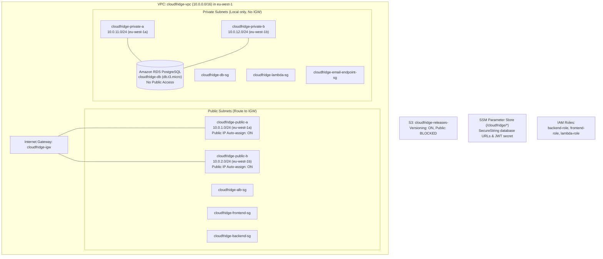
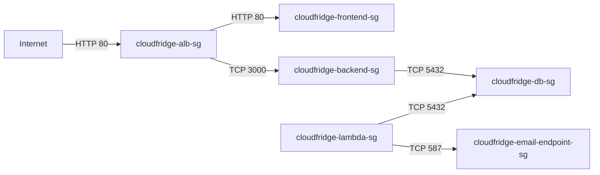

# Phase 2: Foundation Walkthrough

> **Status:** Ready to execute (In Progress)  
> **Region:** `eu-west-1` (Ireland)  
> **Prefix:** `cloudfridge-` | **Tag:** `Project=cloudfridge`  
> *(When all steps below are finished, update this status to **Done ✅** and record the resource IDs below).*

---

## 1. Objective

Build the core AWS cloud networking, security, storage, and database infrastructure in **`eu-west-1` (Ireland)**. When finished, AWS will be fully prepared to receive the application deployments in Phase 3.

---

## 2. Resource Inventory Table

*Fill in this table as each resource is created:*

| Resource | Name / Key | AWS ID or Endpoint | Status |
| --- | --- | --- | --- |
| Budget Alert | `cloudfridge-monthly-budget` | N/A | Pending |
| VPC | `cloudfridge-vpc` | `vpc-` | Pending |
| Internet Gateway | `cloudfridge-igw` | `igw-` | Pending |
| Public Subnet A | `cloudfridge-public-a` (`10.0.1.0/24`) | `subnet-` | Pending |
| Public Subnet B | `cloudfridge-public-b` (`10.0.2.0/24`) | `subnet-` | Pending |
| Private Subnet A | `cloudfridge-private-a` (`10.0.11.0/24`) | `subnet-` | Pending |
| Private Subnet B | `cloudfridge-private-b` (`10.0.12.0/24`) | `subnet-` | Pending |
| Public Route Table | `cloudfridge-public-rt` | `rtb-` | Pending |
| Private Route Table | `cloudfridge-private-rt` | `rtb-` | Pending |
| Security Group: ALB | `cloudfridge-alb-sg` | `sg-` | Pending |
| Security Group: Frontend | `cloudfridge-frontend-sg` | `sg-` | Pending |
| Security Group: Backend | `cloudfridge-backend-sg` | `sg-` | Pending |
| Security Group: Lambda | `cloudfridge-lambda-sg` | `sg-` | Pending |
| Security Group: RDS | `cloudfridge-db-sg` | `sg-` | Pending |
| Security Group: SES Endpoint | `cloudfridge-email-endpoint-sg` | `sg-` | Pending |
| IAM Role: Backend | `cloudfridge-backend-role` | `arn:aws:iam::...` | Pending |
| IAM Role: Frontend | `cloudfridge-frontend-role` | `arn:aws:iam::...` | Pending |
| IAM Role: Lambda | `cloudfridge-lambda-role` | `arn:aws:iam::...` | Pending |
| S3 Bucket: Releases | `cloudfridge-releases-<suffix>` | `s3://...` | Pending |
| DB Subnet Group | `cloudfridge-db-subnet-group` | N/A | Pending |
| RDS PostgreSQL | `cloudfridge-db` (`db.t3.micro`) | `<endpoint>:5432` | Pending |
| SSM Parameter | `/cloudfridge/db/admin-url` | SecureString | Pending |
| SSM Parameter | `/cloudfridge/db/app-url` | SecureString | Pending |
| SSM Parameter | `/cloudfridge/jwt-secret` | SecureString | Pending |

---

## 3. Architecture



---

## 4. Step-by-Step Walkthrough

### Step 0: Cost Protection (AWS Budget Alert)
1. Open the **AWS Budgets** console.
2. Click **Create budget** → Choose **Cost budget**.
3. Name: `cloudfridge-monthly-budget`.
4. Budgeted amount: `$20.00` monthly.
5. Set alert threshold 1: **Actual > $10 (50%)** → Email notification.
6. Set alert threshold 2: **Actual > $20 (100%)** → Email notification.
7. Click **Create budget**.

---

### Step 1: VPC, Subnets, and Routing (Region: `eu-west-1`)

#### 1.1 Create the VPC
1. VPC Console → **VPCs** → **Create VPC**.
2. Select **VPC only**.
3. **Name tag:** `cloudfridge-vpc`.
4. **IPv4 CIDR block:** `10.0.0.0/16`.
5. Tag: `Project=cloudfridge`. Click **Create VPC**.
6. Select `cloudfridge-vpc` → **Actions** → **Edit VPC settings** → Check **Enable DNS hostnames** → **Save changes**.

#### 1.2 Internet Gateway
1. VPC Console → **Internet gateways** → **Create internet gateway**.
2. **Name tag:** `cloudfridge-igw`. Click **Create internet gateway**.
3. Click **Actions** → **Attach to VPC** → Select `cloudfridge-vpc` → **Attach**.

#### 1.3 Subnets (4 subnets across 2 AZs)
Go to **Subnets** → **Create subnet** → VPC: `cloudfridge-vpc`:
- Subnet 1: `cloudfridge-public-a` | AZ: `eu-west-1a` | CIDR: `10.0.1.0/24`
- Subnet 2: `cloudfridge-public-b` | AZ: `eu-west-1b` | CIDR: `10.0.2.0/24`
- Subnet 3: `cloudfridge-private-a` | AZ: `eu-west-1a` | CIDR: `10.0.11.0/24`
- Subnet 4: `cloudfridge-private-b` | AZ: `eu-west-1b` | CIDR: `10.0.12.0/24`

*Enable public IP on public subnets:*
- Select `cloudfridge-public-a` → **Actions** → **Edit subnet settings** → Check **Enable auto-assign public IPv4 address** → **Save**.
- Repeat for `cloudfridge-public-b`.

#### 1.4 Route Tables
1. **Public Route Table:**
   - Create Route Table: `cloudfridge-public-rt` in `cloudfridge-vpc`.
   - **Routes** tab → **Edit routes** → Add route: `0.0.0.0/0` → Target: Internet Gateway (`cloudfridge-igw`) → **Save changes**.
   - **Subnet associations** tab → **Edit subnet associations** → Check `cloudfridge-public-a` and `cloudfridge-public-b` → **Save**.
2. **Private Route Table:**
   - Create Route Table: `cloudfridge-private-rt` in `cloudfridge-vpc`.
   - Keep default route (`10.0.0.0/16` → local). *No internet route!*
   - **Subnet associations** tab → Check `cloudfridge-private-a` and `cloudfridge-private-b` → **Save**.

---

### Step 2: The 6 Security Groups (in `cloudfridge-vpc`)

Create empty security groups first, then fill in cross-referencing inbound rules:



| Security Group | Inbound Type | Port | Source | Purpose |
| --- | --- | --- | --- | --- |
| **`cloudfridge-alb-sg`** | HTTP | 80 | `0.0.0.0/0` | Public browser traffic |
| **`cloudfridge-frontend-sg`** | HTTP | 80 | `cloudfridge-alb-sg` | Only ALB reaches frontend nginx |
| **`cloudfridge-backend-sg`** | Custom TCP | 3000 | `cloudfridge-alb-sg` | Only ALB reaches Express API |
| **`cloudfridge-lambda-sg`** | *(None)* | — | *(No inbound rules)* | Lambda initiates connections only |
| **`cloudfridge-db-sg`** | PostgreSQL | 5432 | `cloudfridge-backend-sg` | Backend reads/writes DB |
| | PostgreSQL | 5432 | `cloudfridge-lambda-sg` | Daily alert Lambda reads DB |
| **`cloudfridge-email-endpoint-sg`** | Custom TCP | 587 | `cloudfridge-lambda-sg` | Alert Lambda connects to SES SMTP |

---

### Step 3: IAM Roles & Policies

1. **`cloudfridge-backend-role` (EC2 service):**
   - Managed policy: `AmazonSSMManagedInstanceCore`
   - Inline policy `cloudfridge-backend-policy`:
     ```json
     {
       "Version": "2012-10-17",
       "Statement": [
         {
           "Sid": "ReadAppParameters",
           "Effect": "Allow",
           "Action": ["ssm:GetParameter", "ssm:GetParameters", "ssm:GetParametersByPath"],
           "Resource": "arn:aws:ssm:eu-west-1:*:parameter/cloudfridge/*"
         },
         {
           "Sid": "ReadReleases",
           "Effect": "Allow",
           "Action": ["s3:GetObject", "s3:ListBucket"],
           "Resource": ["arn:aws:s3:::cloudfridge-releases-*", "arn:aws:s3:::cloudfridge-releases-*/*"]
         },
         {
           "Sid": "ManagePhotos",
           "Effect": "Allow",
           "Action": ["s3:GetObject", "s3:PutObject", "s3:DeleteObject"],
           "Resource": "arn:aws:s3:::cloudfridge-photos-*/*"
         }
       ]
     }
     ```
2. **`cloudfridge-frontend-role` (EC2 service):**
   - Managed policy: `AmazonSSMManagedInstanceCore`
   - Inline policy `cloudfridge-frontend-policy`:
     ```json
     {
       "Version": "2012-10-17",
       "Statement": [
         {
           "Sid": "ReadReleases",
           "Effect": "Allow",
           "Action": ["s3:GetObject", "s3:ListBucket"],
           "Resource": ["arn:aws:s3:::cloudfridge-releases-*", "arn:aws:s3:::cloudfridge-releases-*/*"]
         }
       ]
     }
     ```
3. **`cloudfridge-lambda-role` (Lambda service):**
   - Managed policy: `AWSLambdaVPCAccessExecutionRole`

---

### Step 4: S3 Releases Bucket
1. S3 Console → **Create bucket**.
2. **Bucket name:** `cloudfridge-releases-<unique-suffix>` (e.g. `cloudfridge-releases-mohand`).
3. **Region:** `eu-west-1`.
4. **Block *all* public access:** Checked.
5. **Bucket Versioning:** **Enable** (allows rollbacks in Phase 3).
6. **Default encryption:** SSE-S3.
7. Click **Create bucket**.

---

### Step 5: Amazon RDS PostgreSQL Database

1. **Create DB Subnet Group:**
   - RDS Console → **Subnet groups** → **Create DB subnet group**.
   - Name: `cloudfridge-db-subnet-group` | VPC: `cloudfridge-vpc`.
   - Add Subnets: AZs `eu-west-1a` & `eu-west-1b` → select the private subnets `10.0.11.0/24` and `10.0.12.0/24`.
2. **Create Database Instance:**
   - Engine: PostgreSQL 16 (or 15).
   - Template: Free tier (or Dev/Test).
   - DB instance identifier: `cloudfridge-db`.
   - Master username: `postgres`.
   - Master password: Enter a strong random password (save it safely!).
   - Instance class: `db.t3.micro`.
   - Storage: General Purpose SSD (`gp3` or `gp2`), 20 GiB. **Uncheck** "Enable storage autoscaling".
   - Connectivity:
     - VPC: `cloudfridge-vpc`.
     - DB Subnet Group: `cloudfridge-db-subnet-group`.
     - Public access: **No** *(CRITICAL: private only)*.
     - Security group: `cloudfridge-db-sg` (remove `default`).
   - Additional Configuration:
     - Initial database name: `cloudfridge`.
     - Backup retention: 1 day.
     - Encryption: Enabled (`aws/rds`).
     - Disable Performance Insights & Enhanced Monitoring (to save credits).
   - Click **Create database**.

---

### Step 6: SSM Parameter Store Secrets

In AWS Systems Manager → **Parameter Store** (Region: `eu-west-1`), create 3 parameters:

1. `/cloudfridge/db/admin-url`:
   - Type: `SecureString`
   - Value: `postgres://postgres:<MASTER_PASSWORD>@<RDS_ENDPOINT>:5432/cloudfridge`
2. `/cloudfridge/db/app-url`:
   - Type: `SecureString`
   - Value: `postgres://cloudfridge_app:<APP_DB_PASSWORD>@<RDS_ENDPOINT>:5432/cloudfridge`
   *(App password generated via `crypto.randomBytes(16).toString('hex')`)*
3. `/cloudfridge/jwt-secret`:
   - Type: `SecureString`
   - Value: `<64-character-random-hex-string>`

---

## 5. Phase 2 Verification ("Done When")

### 1. Verification Test
From your laptop terminal:
```bash
psql -h <RDS_ENDPOINT> -U postgres -d cloudfridge --connect-timeout 5
```
**Required Result:** Connection must hang and time out. The database must **not** be reachable from the internet.

### 2. Update Documentation When Done
1. Change **Status** at the top of this document to:  
   `> **Status:** Done ✅ (<Date>)`
2. Fill in the **Resource Inventory Table** with the actual AWS IDs and endpoints.
3. Update [docs/status.md](status.md) Current State and AWS Resources tables.
