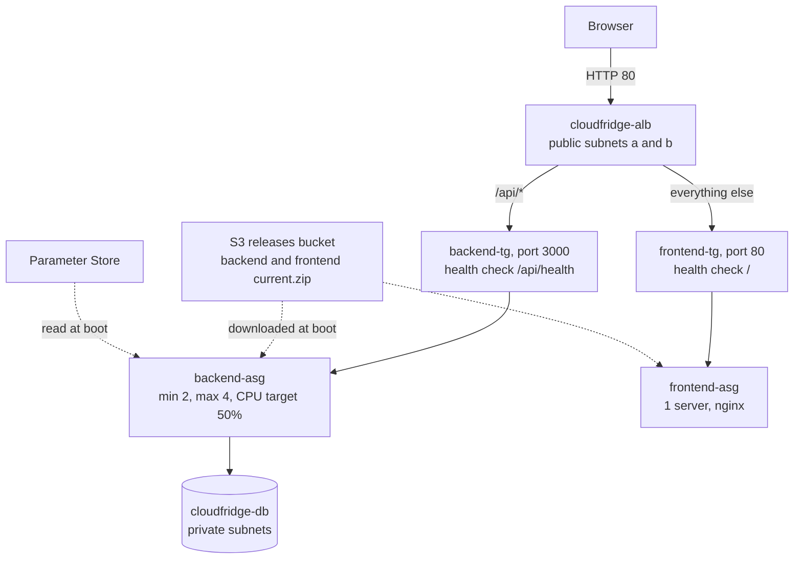

# Phase 3: Deployment and Scaling Walkthrough

> **Status:** Done ✅ (10 November 2026). Both ASGs are at 0, the load balancer and RDS are deleted, and `cloudfridge-dashboard` was created in Phase 6 (`p6-scaling.png`). See [Results](#7-results).
> **Region:** `eu-west-1` (Ireland). Check the region selector before every step.
> **Names and tags:** prefix `cloudfridge-`, tag `Project=cloudfridge` on everything that accepts tags.
> **Screenshots:** 4, marked 📸. Everything else goes in the report's text.
> **Time:** two sessions. **Session A** (steps 0 to 7, about 3 hours) gets the app running through the load balancer. **Session B** (steps 8 to 11, about 1.5 hours) adds scaling and self-healing.

---

## 1. Objective

Put the app from Phase 1 on the AWS foundation from Phase 2. At the end, one public load balancer address serves the React app and the API, the backend runs on 2 servers that scale between 2 and 4, a failed server gets replaced automatically, and the database is still private.

**Cost:** this is where spending starts. Each running `t3.micro` server, its public IPv4 address, the load balancer and RDS all charge by the hour. Budget about \$0.15 per hour for everything together, and **end each session with step 12**.

---

## 2. Resource table

Fill this in as you go.

| Resource | Name | ID or address |
| --- | --- | --- |
| Backend release | `s3://cloudfridge-releases-m1/backend/current.zip` | Uploaded 10 Nov |
| Frontend release | `s3://cloudfridge-releases-m1/frontend/current.zip` | 2 versions: original, and "CloudFridge V2" title (current) |
| Launch template | `cloudfridge-backend-lt` | `lt-0b4f75be57ec468aa` |
| Launch template | `cloudfridge-frontend-lt` | `lt-0eb6f06a13a510ef0` |
| Target group | `cloudfridge-frontend-tg` (port 80) | Kept (free) |
| Target group | `cloudfridge-backend-tg` (port 3000) | Kept (free) |
| Load balancer | `cloudfridge-alb` | **Deleted** at the end of the session. Was `cloudfridge-alb-949062867.eu-west-1.elb.amazonaws.com`, used in `p3-app.png`. The address changes when it's recreated. |
| Auto Scaling group | `cloudfridge-frontend-asg` | Kept, at 0 (normal size 1/1/1) |
| Auto Scaling group | `cloudfridge-backend-asg` | Kept, at 0 (normal size min 2, desired 2, max 4) |
| Scaling policy | `cloudfridge-backend-cpu50` | Target tracking, CPU 50%, warmup 120 s |
| Dashboard | `cloudfridge-dashboard` | Created in Phase 6 (`p6-scaling.png`) |

---

## 3. What you're building



---

## 4. Steps

### Step 0: Start the session

1. **RDS** → `cloudfridge-db` → **Actions** → **Start**. Wait for **Available** (about 5 minutes). Do step 1 while it starts.
2. **Billing and Cost Management** → **Cost allocation tags** → tick `Project` → **Activate**. It should be listed now, a day after Phase 2.
3. **Budgets** → open the budget → **Edit** → **Advanced options**: **Credits** must be unticked.
4. Copy the IDs marked `look up` in the Phase 2 resource table. You'll need the subnet and security group names below, and the bucket name in step 2.

### Step 1: Prepare the files locally

The release script, the systemd unit and both startup scripts are already in the repository:

| File | Purpose |
| --- | --- |
| `scripts/package.sh` | Builds `release/backend/current.zip` and `release/frontend/current.zip` |
| `backend/deploy/cloudfridge-api.service` | systemd unit for the API |
| `infra/user-data/backend.sh` | Backend startup script |
| `infra/user-data/frontend.sh` | Frontend startup script |

**1.1 Download the RDS CA bundle.** The backend verifies the database's TLS certificate with it:

```bash
curl -o backend/deploy/rds-ca-bundle.pem https://truststore.pki.rds.amazonaws.com/global/global-bundle.pem
```

It's a public file, so it can go into Git.

**1.2 Set the bucket name** in both startup scripts: replace `cloudfridge-releases-CHANGE_ME` with your real bucket name (the `<suffix>` you picked in Phase 2).

### Step 2: Build and upload the releases

```bash
scripts/package.sh
```

This installs production dependencies, builds the React app and creates both zips under `release/`. The backend zip contains `src/`, `migrations/`, `scripts/`, `deploy/` and `node_modules/`, so servers never run `npm`.

**S3** console → `cloudfridge-releases-<suffix>` → **Create folder** `backend` and `frontend` → upload each file into its own folder:

- `release/backend/current.zip` → `backend/current.zip`
- `release/frontend/current.zip` → `frontend/current.zip`

📸 `p3-s3-releases.png`: the bucket with the `backend/` and `frontend/` folders (open one so `current.zip` shows too, or show both in two panes). It proves **S3** is used.

### Step 3: Launch templates

**EC2** → **Launch templates** → **Create launch template**. Tag the template and its instances with `Project` = `cloudfridge` (**Resource tags** → **Instances**).

**3.1 `cloudfridge-backend-lt`**

| Setting | Value |
| --- | --- |
| AMI | Amazon Linux 2023 (Quick Start) |
| Instance type | `t3.micro` |
| Key pair | **Don't include in launch template** (Session Manager only) |
| Subnet | Don't include (the ASG chooses) |
| Security group | `cloudfridge-backend-sg` |
| Advanced → IAM instance profile | `cloudfridge-backend-role` |
| Advanced → Detailed CloudWatch monitoring | **Enable** |
| Advanced → User data | The whole content of `infra/user-data/backend.sh` |

Before pasting, note the Node.js package name. `backend.sh` uses `nodejs22`, because the project targets Node 22. If the first server fails at `dnf install` (see the troubleshooting table), connect with Session Manager, run `dnf list 'nodejs*'`, and update `NODE_PACKAGE` in a new launch template version. `nodejs20` also works, as the code ran on Node 20 locally.

**3.2 `cloudfridge-frontend-lt`**

Same settings, except: security group `cloudfridge-frontend-sg`, instance profile `cloudfridge-frontend-role`, and user data from `infra/user-data/frontend.sh`.

> **Public IP:** the public subnets auto-assign one, which the servers need to reach S3 and Parameter Store (there's no NAT gateway). If an instance later has no public IP, open the template → **Advanced network configuration** → **Auto-assign public IP** → **Enable**.

### Step 4: Target groups

**EC2** → **Target Groups** → **Create target group**, type **Instances**, protocol **HTTP**, VPC `cloudfridge`. Don't register any targets: the ASGs do that.

| Setting | `cloudfridge-frontend-tg` | `cloudfridge-backend-tg` |
| --- | --- | --- |
| Port | 80 | 3000 |
| Health check path | `/` | `/api/health` |
| Healthy / unhealthy threshold | 2 / 2 | 2 / 2 |
| Interval, timeout | 15 s, 5 s | 15 s, 5 s |

After creating each one: **Attributes** → **Edit** → **Deregistration delay** `30` seconds. (The default, 300, makes scale-in and replacement slow.)

### Step 5: Load balancer

**EC2** → **Load Balancers** → **Create** → **Application Load Balancer**.

| Setting | Value |
| --- | --- |
| Name | `cloudfridge-alb` |
| Scheme | Internet-facing, IPv4 |
| VPC / subnets | `cloudfridge`; `cloudfridge-public-a` and `cloudfridge-public-b` |
| Security group | `cloudfridge-alb-sg` only (remove `default`) |
| Listener | HTTP 80 → default action forwards to `cloudfridge-frontend-tg` |
| Tag | `Project` = `cloudfridge` |

Then open the listener → **Add rule**: if **Path** is `/api/*`, forward to `cloudfridge-backend-tg`. Priority `10`.

Copy the load balancer's **DNS name**: this is the app's address.

### Step 6: Auto Scaling groups (start small)

Create the backend group with **min, max and desired all 1** for now. That makes the first startup easy to debug, and gives one server for the database setup in step 7.

**EC2** → **Auto Scaling Groups** → **Create**.

**6.1 `cloudfridge-frontend-asg`**

| Setting | Value |
| --- | --- |
| Launch template | `cloudfridge-frontend-lt` |
| VPC / subnets | `cloudfridge`; both **public** subnets |
| Load balancing | Attach to existing: `cloudfridge-frontend-tg` |
| Health checks | Turn on **Elastic Load Balancing health checks**; grace period `180` seconds |
| Group size | Desired 1, min 1, max 1 |
| Scaling policy | None |
| Monitoring | Enable group metrics collection within CloudWatch |
| Tag | `Project` = `cloudfridge` (propagate to instances) |

**6.2 `cloudfridge-backend-asg`**

Same, with launch template `cloudfridge-backend-lt`, target group `cloudfridge-backend-tg`, and group size desired **1**, min **1**, max **1**.

Wait about 3 minutes. In **Target Groups**, both targets should reach **healthy**. If a target stays unhealthy or the ASG keeps replacing servers, see [Troubleshooting](#6-troubleshooting).

### Step 7: Create the app database user and tables

The database is private, so run the setup **from the backend server**, through Session Manager.

1. **EC2** → **Instances** → select the backend instance → **Connect** → **Session Manager** → **Connect**.
   *If the button is greyed out or the connect fails, see [Troubleshooting](#6-troubleshooting).*
2. In the shell:

```bash
sudo -i
cd /opt/cloudfridge
export AWS_DEFAULT_REGION=eu-west-1
export DATABASE_URL=$(aws ssm get-parameter --name /cloudfridge/db/admin-url --with-decryption --query Parameter.Value --output text)
read -rs -p 'APP_DB_PASSWORD: ' APP_DB_PASSWORD; echo   # paste it; it isn't shown or saved in history
export APP_DB_PASSWORD
node scripts/bootstrap-db.js
```

It prints `Created cloudfridge_app`.

3. Run the migrations with the same admin URL. `node-pg-migrate` needs TLS settings in the URL, and Node must trust the RDS certificate:

```bash
export NODE_EXTRA_CA_CERTS=/opt/cloudfridge/deploy/rds-ca-bundle.pem
export DATABASE_URL="$DATABASE_URL?sslmode=require"
node node_modules/node-pg-migrate/bin/node-pg-migrate.js up -m migrations
```

It lists the `1730000000000_init` migration as migrated. Then `exit` twice.

4. Restart the API so it connects cleanly: `sudo systemctl restart cloudfridge-api`.

> **Never paste the admin URL or passwords into a screenshot, or into the report.** Close the session when done.

### Step 8: Check the app works

Open `http://<load balancer DNS name>` in a browser (plain HTTP, not HTTPS). Then:

1. Register with a **test** email and password (there's no HTTPS, so never use a real password).
2. Add 4 items with expiry dates of yesterday, today, in 5 days and in 20 days. You should see grey, red, amber and green.
3. Mark one item as used, and open **Statistics**.
4. Reload the **Statistics** page (address `/stats`; this tests the nginx `try_files` rule).

📸 `p3-app.png`: the dashboard with the colored items, with the **load balancer address in the address bar**. Don't show a real email address.

Also check privacy: from your laptop, `curl -m 5 http://<backend instance public IP>:3000/api/health` must **time out**. The security group only allows port 3000 from the load balancer. Write the result down for the report.

---

### Session A ends here

Do step 12 (end the session) now, or continue to Session B.

---

### Step 9: Scale the backend

1. **Backend ASG** → **Edit** → desired `2`, min `2`, max `4`. Check the two servers sit in **different Availability Zones**.
2. **Automatic scaling** → **Create dynamic scaling policy**: type **Target tracking scaling**, name `cloudfridge-backend-cpu50`, metric **Average CPU utilization**, target `50`, **Instance warmup** `120` seconds.
3. Wait for 2 healthy targets in `cloudfridge-backend-tg`.

📸 `p3-ec2-instances.png`: **EC2** → **Instances**, showing 3 running instances (1 frontend, 2 backend) with the **Availability Zone** column visible. Widen the columns so the names and zones show.

📸 `p3-target-groups.png`: **Target Groups** → `cloudfridge-backend-tg` → **Targets** tab, with 2 **healthy** targets. This is the key **load balancer** image.

### Step 10: Test self-healing

1. In **Instances**, select one backend instance → **Instance state** → **Terminate**.
2. Refresh the app in the browser a few times: it keeps working, since the other server handles requests.
3. In the backend ASG → **Activity** tab, watch the replacement launch. Wait until 2 targets are healthy again.

Write down the times for the report. This activity history is also the evidence for Phase 6 (`p6-asg-activity`), so leave it in place.

### Step 11: Test a release with an instance refresh

1. Make a small visible change (for example, edit the title in `frontend/index.html`), then `scripts/package.sh` and upload the new `frontend/current.zip`, replacing the old one (bucket versioning keeps the previous version).
2. **Frontend ASG** → **Instance refresh** → **Start**, minimum healthy `0` (there's only one server, so a brief interruption is expected).
3. For the backend, run a refresh with minimum healthy **50%**, which replaces one server at a time without downtime.
4. To roll back: **S3** → open the object → **Versions** → restore the previous version, and refresh again.

**Monitoring:** **CloudWatch** → **Dashboards** → create `cloudfridge-dashboard` with 3 widgets: backend ASG **Average CPUUtilization**, `HealthyHostCount` for `cloudfridge-backend-tg`, and the load balancer's `HTTPCode_Target_5XX_Count`.

### Step 12: End the session

1. **Backend ASG** and **frontend ASG** → **Edit** → desired, min `0`. (The min must go to 0 first, otherwise the group refills.) Wait for the instances to terminate: this removes their public IP charges.
2. **RDS** → `cloudfridge-db` → **Actions** → **Stop temporarily**.
3. If the next session is more than a few days away, also **delete the load balancer** (it charges by the hour even when idle). Its address changes when you recreate it.
4. Fill in the resource table above, and update [status.md](status.md): current state, AWS resources and session log (with the spend from **Billing**).
5. Save the screenshots in `docs/evidence/`.

**Next session (Phase 4 or Phase 6):** Phase 4 (Daily alerts) does not need the load balancer or EC2 servers — only RDS needs to be started when testing the Lambda. When you later recreate `cloudfridge-alb` (for Phase 6 load testing), create `cloudfridge-dashboard` from [step 11](#step-11-test-a-release-with-an-instance-refresh) then so its widgets point to the active ALB.

---

## 5. Done when

- [x] Both `current.zip` files are in the releases bucket.
- [x] Both launch templates, both target groups and the load balancer exist. (The load balancer was deleted afterwards to save cost.)
- [x] The full app works through the load balancer address.
- [x] The backend has 2 healthy servers in different Availability Zones.
- [x] Calling a server's public IP directly fails.
- [x] A terminated backend server is replaced, and the app keeps working.
- [x] An instance refresh completes, and rollback through S3 versioning is understood.
- [x] The CPU target tracking policy exists at 50%.
- [x] The `cloudfridge-dashboard` dashboard exists *(created in Phase 6, `p6-scaling.png`)*.
- [x] Both ASGs are at 0, and RDS is stopped.

## Screenshot checklist

- [x] `p3-s3-releases.png`
- [x] `p3-app.png` (plus an extra, `p3-app2.png`)
- [x] `p3-ec2-instances.png`
- [x] `p3-target-groups.png`
- [x] Extra: `p3-self-healing.png`, the backend ASG activity after the terminate test. The final `p6-asg-activity.png` is taken in Phase 6, once scale-out and scale-in are in the history too.

Write down for the report, without screenshots: the launch template settings, the listener rule, the health check and timing settings, the scaling policy, and the self-healing and refresh results.

---

## 6. Troubleshooting

| Symptom | Likely cause | What to do |
| --- | --- | --- |
| ASG keeps replacing servers | Startup script failed, or wrong health check path | **ASG** → **Activity**. Temporarily switch the ASG health check to **EC2** only so a server lives long enough to inspect, then read `/var/log/cloud-init-output.log` through Session Manager. |
| Backend target unhealthy, `journalctl -u cloudfridge-api` shows `Missing required environment variable` | Parameter lookup failed | Check the role has the inline policy and the parameter names match exactly. |
| Backend log shows a TLS or certificate error | CA bundle missing from the zip | Check `backend/deploy/rds-ca-bundle.pem` exists, then rebuild, upload and refresh. |
| Session Manager **Connect** fails or is greyed out | The instance has no role, no public IP, or the agent isn't registered yet | Wait 2 to 3 minutes. Check the instance profile is `cloudfridge-backend-role` and it has `AmazonSSMManagedInstanceCore`. |
| `aws s3 cp` fails in the startup script | No public IP, or the role can't read the bucket | Check the bucket name in the script and the role's `ReadReleases` statement. |
| `dnf install` can't find the Node package | Wrong package name | Run `dnf list 'nodejs*'` and update `NODE_PACKAGE`. |
| Load balancer returns 502 or 503 | No healthy targets | **Target Groups** → **Targets**, and the health check path and port. |
| `cloudfridge-api` fails with `status=203/EXEC` | `/usr/bin/node` doesn't exist | `ls /usr/bin/node*`. The startup script links `node` to the versioned binary; check that line ran in `/var/log/cloud-init-output.log`. |
| nginx fails to start, `nginx -t` reports a duplicate `location "/"` | The default config already has a `location /` block | Remove the empty `location / {}` from `/etc/nginx/nginx.conf`, then `sudo systemctl restart nginx`. |
| Page reload gives 404 | The `try_files` rule is missing | Check `/etc/nginx/default.d/spa.conf` exists, and `sudo systemctl restart nginx`. |
| `node-pg-migrate` fails with a TLS or `self-signed` error | The CA isn't trusted by Node | Check `NODE_EXTRA_CA_CERTS` is exported and points to the bundle. As a last resort, connect with `?sslmode=no-verify` for this one-off admin command only, and write it down in the report. |
| Registering returns 500 | `cloudfridge_app` or the tables don't exist yet | Repeat step 7 and check the backend log. |
| `bootstrap-db.js` fails with `getaddrinfo ENOTFOUND` | Typo in the RDS endpoint inside a Parameter Store URL | Happened on 10 Nov: the parameters had `wes0jts` instead of `was0jts`. Fix both `/cloudfridge/db/*` parameters, then on a running server run `sed -i 's/<wrong>/<right>/' /etc/cloudfridge.env` and restart the API (new servers read the fixed value at boot). |
| Pasting a block that starts with `sudo -i` does nothing after the first line | `sudo -i` opens a new shell, which drops the rest of the paste | Run `sudo -i` alone, then paste the rest. Run the `read` line for the password on its own too. |
| Instance refresh finishes without replacing anything | **Enable skip matching** was ticked, and only the S3 zip changed, not the launch template | Start it again with **skip matching unticked**. |
| `node-pg-migrate` prints `SECURITY WARNING: The SSL modes 'prefer', 'require' ...` | `pg` treats `sslmode=require` as `verify-full` for now | Harmless: the certificate is still verified. Could use `sslmode=verify-full` to silence it. |

---

## 7. Results

Recorded on 10 November 2026, for the report.

| Check | Result |
| --- | --- |
| Releases | Both zips built with `scripts/package.sh` and uploaded to `cloudfridge-releases-m1` (`p3-s3-releases.png`). The local `EBADENGINE` warning (Node 20 locally, project needs 22) is harmless: the servers run Node 22.23.4. |
| Node.js on the servers | `nodejs22` installed by the startup script with no change needed. |
| Session Manager | Connects to the backend with no SSH rule and no key pair. |
| Database setup | `Created cloudfridge_app`, and migration `1730000000000_init` ran. Needed a Parameter Store endpoint fix first (see troubleshooting). |
| App through the load balancer | Register, 4 urgency colors, mark used, statistics, and reloading `/stats` all work (`p3-app.png`). |
| Direct access to a backend server | `curl -m 5 http://<backend public IP>:3000/api/health` times out. Only the load balancer can reach port 3000. |
| First frontend server | The very first frontend instance was replaced once by the ASG shortly after creation, then the replacement became healthy. No change was needed. |
| Scaling | Backend at min 2, desired 2, max 4, one server in `eu-west-1a` and one in `eu-west-1b` (`p3-ec2-instances.png`, `p3-target-groups.png`). Policy `cloudfridge-backend-cpu50`. |
| Self-healing | Terminated `i-090999ab4956b2441` at 15:54:59 (CET). The ASG started replacement `i-05043af59dee7e79b` at 15:55:00, launched by 15:55:10, and the app stayed up on the other server throughout. Evidence: `p3-self-healing.png` and the ASG **Activity** tab. |
| Frontend instance refresh | Title changed to "CloudFridge V2", new zip uploaded, refresh with minimum healthy 0% (skip matching off). The new title appeared after the refresh. |
| Backend instance refresh | Minimum healthy 50%, one server at a time, completed. |
| Rollback | Both versions of `frontend/current.zip` are listed under **Versions**. The site was left on V2. |
| Dashboard | Created in Phase 6 (`cloudfridge-dashboard` with `CPUUtilization` and `HealthyHostCount`, shown in `p6-scaling.png`). |
