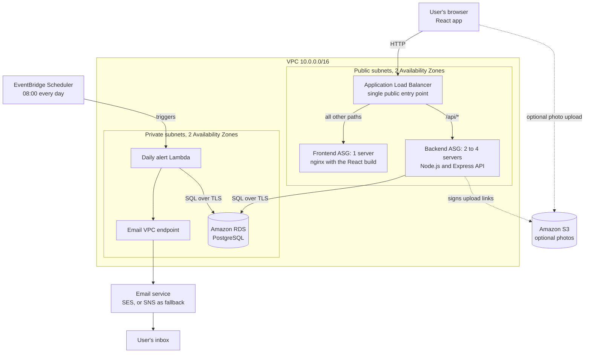
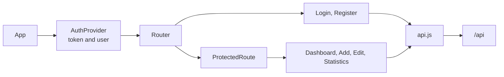
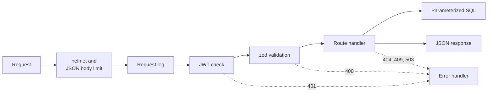
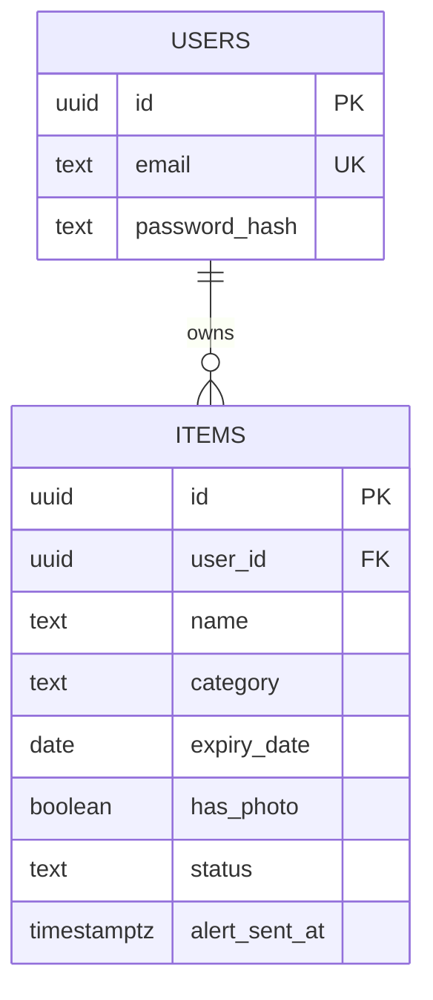
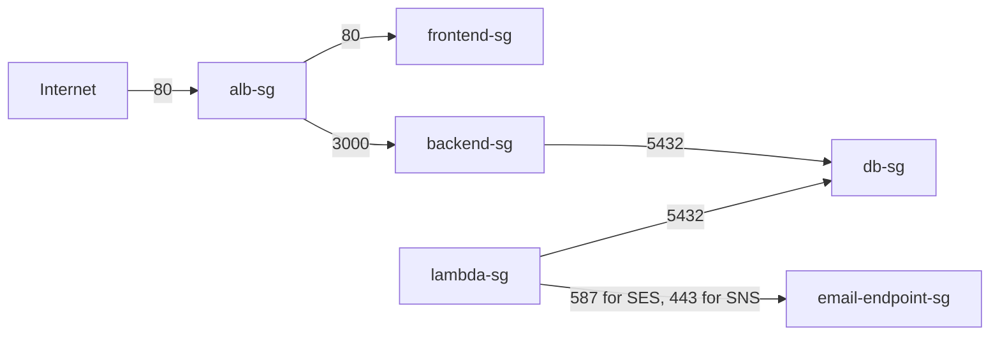
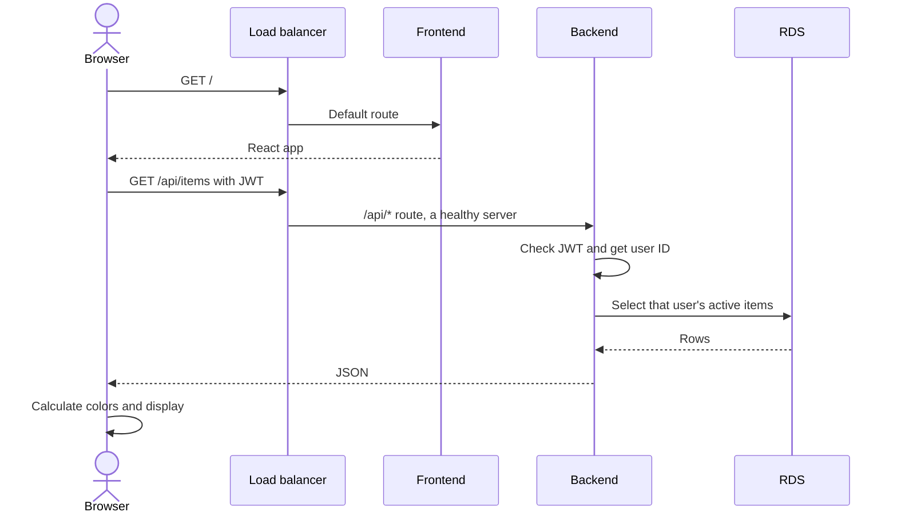
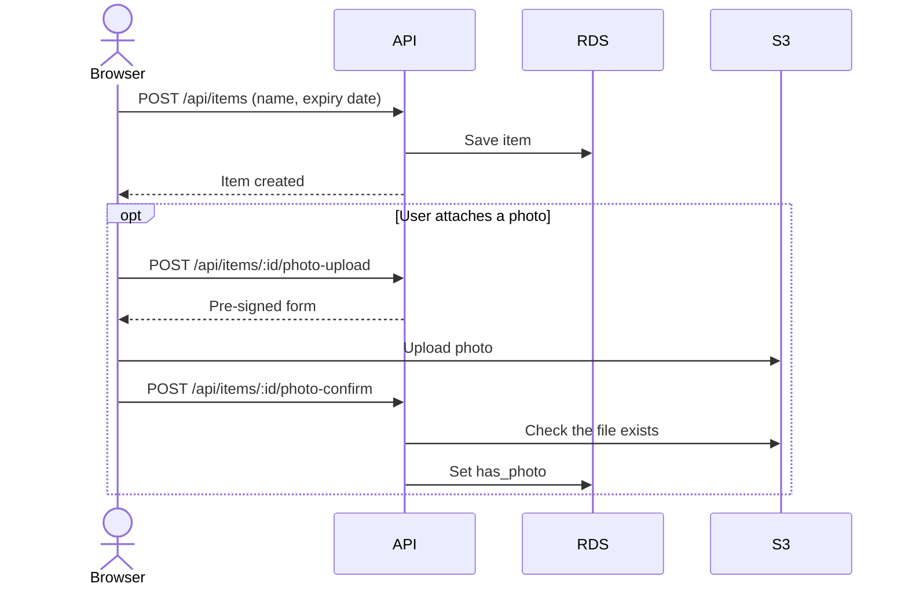
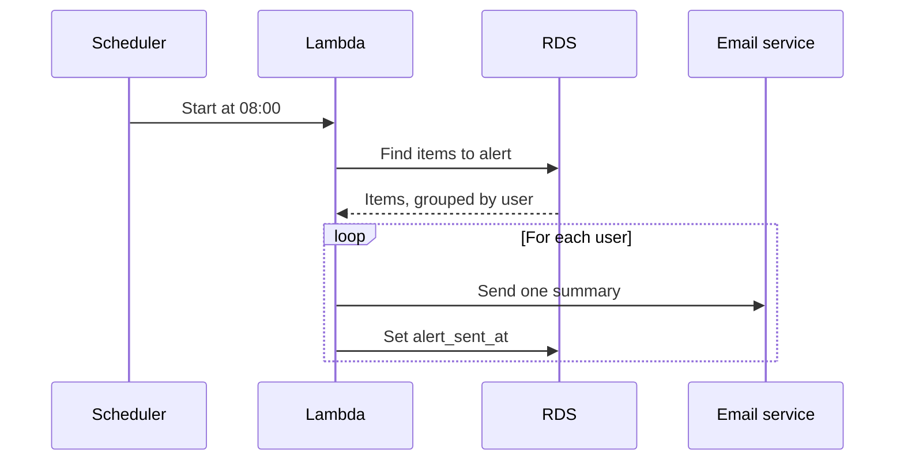
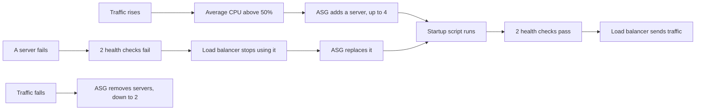
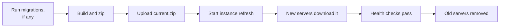

# CloudFridge: Project Guide

A cloud-based food expiry tracker, built on AWS.

This guide covers the design and the plan. Progress, AWS account facts and the resources that exist so far are in [status.md](status.md).

**Status:** Phase 1 is done. Phase 2 is next. Region: `eu-west-1`. Email path: SES.

**Contents:** [1 Overview](#1-overview) · [2 Big picture](#2-big-picture) · [3 Frontend](#3-frontend-layer) · [4 Backend](#4-backend-layer) · [5 Database](#5-database-layer) · [6 Alerts](#6-alert-layer) · [7 Storage](#7-storage-layer) · [8 Infrastructure](#8-infrastructure-layer) · [9 How it comes together](#9-how-it-all-comes-together) · [10 Decisions](#10-design-decisions) · [11 Phases](#11-implementation-phases) · [12 Cost](#12-cost-control) · [13 Limitations](#13-known-limitations) · [14 Troubleshooting](#14-troubleshooting) · [15 Future plans](#15-future-plans)

---

## 1. Overview

Households throw away food because they forget what they have and when it expires. CloudFridge lets users record their food and emails them before anything goes bad.

### Features

| Feature | Behavior |
| --- | --- |
| Accounts | Register with an email and password. Each user sees only their own items. |
| Add items | **Name and expiry date are required.** Category and photo are optional. |
| Dashboard | Active items, soonest expiry first, colored by urgency. |
| Email alerts | One daily email per user listing items that expire in the next 2 days. |
| Used or wasted | Marking an item removes it from the dashboard and counts it in the statistics. |
| Statistics | Used and wasted counts, and the percentage wasted. |

Deleting an item is for mistakes, so it doesn't count in the statistics. An expired item stays on the dashboard until the user marks it.

### Urgency rules

| Days until expiry | Color | In alert email |
| --- | --- | --- |
| Below 0 (expired) | Grey | No |
| 0 to 2 | Red | Yes, once |
| 3 to 7 | Amber | No |
| 8 or more | Green | No |

### Requirements coverage

CloudFridge uses 7 of the 9 listed components, and the minimum is 5. If Lambda and serverless count as one item, it still has 6.

| # | Requirement | Used | Role |
| --- | --- | --- | --- |
| 1 | ASG and Load Balancer | Yes | One load balancer as the entry point, with Auto Scaling Groups running the servers |
| 2 | Amazon S3 | Yes | Release files and optional photos |
| 3 | At least 2 EC2 services | Yes | Frontend and backend API |
| 4 | Amazon RDS | Yes | PostgreSQL database |
| 5 | VPC | Yes | Public and private subnets |
| 6 | Dockerized application | No | Not needed at this size |
| 7 | Serverless solution | Yes | Scheduled alert job |
| 8 | Orchestrator | No | Auto Scaling Groups cover scaling and replacement |
| 9 | AWS Lambda | Yes | Runs the alert job |

---

## 2. Big picture



Dotted lines mark the optional photo feature.

### The layers

| Layer | Technology | Runs on | Responsible for | Section |
| --- | --- | --- | --- | --- |
| Frontend | React, Vite, React Router | Built files on nginx, EC2 | All screens and urgency colors | [3](#3-frontend-layer) |
| Backend | Node.js, Express, `pg`, `zod` | EC2 in an ASG | Accounts, business rules, access control | [4](#4-backend-layer) |
| Database | PostgreSQL | RDS, private subnets | Users, items, alert state | [5](#5-database-layer) |
| Alerts | Node.js | Lambda, private subnets | Daily emails | [6](#6-alert-layer) |
| Storage | S3 | AWS managed | Release files and photos | [7](#7-storage-layer) |
| Infrastructure | VPC, load balancer, ASGs, IAM, CloudWatch | AWS | Networking, routing, scaling, recovery, permissions | [8](#8-infrastructure-layer) |

### Finished system

A user opens one public address, registers and adds food. The dashboard shows what needs eating first, and an email arrives each morning about items expiring soon. Behind that, traffic spikes add servers automatically, a dead server gets replaced, and the database can't be reached from the internet.

---

## 3. Frontend layer

A single-page React app. It holds no secrets and has no business rules except urgency colors. It calls the API at the relative path `/api`, so the build needs no server address.

### Structure



```text
frontend/src/
├── main.jsx              Entry point
├── App.jsx               Routes
├── api.js                fetch wrapper
├── auth/                 AuthProvider, ProtectedRoute
├── pages/                One file per page
├── components/           ItemCard, ItemForm, NavBar, and PhotoField in Phase 5
└── utils/urgency.js      Days left and color
```

### Pages

| Route | Page | Shows | API calls |
| --- | --- | --- | --- |
| `/login` | Login | Email and password form | `POST /api/auth/login` |
| `/register` | Register | Email and password form | `POST /api/auth/register` |
| `/` | Dashboard | Item cards with color, days left, optional thumbnail, and Used, Wasted, Edit and Delete actions | `GET /api/items`, `PATCH`, `DELETE` |
| `/items/new` | Add item | Name, expiry date, optional category and photo | `POST /api/items`, then the photo calls |
| `/items/:id/edit` | Edit item | Same form, filled in | `GET /api/items/:id`, `PATCH`, photo calls |
| `/stats` | Statistics | Used count, wasted count, waste percentage | `GET /api/stats` |

### Rules

- **State:** the auth context holds the token and user, and each page fetches its own data. No Redux is needed.
- **Sessions:** the token lives in `localStorage`. `api.js` adds it as a `Bearer` header, and any 401 clears it and redirects to `/login`.
- **Dates:** the API sends dates as `YYYY-MM-DD` strings. Calculate days left from the year, month and day parts in `urgency.js`, because `new Date("2026-11-05")` is read as UTC and can be off by a day.
- **Photos:** the form saves the item first, then uploads the photo. A failed upload shows a message but keeps the item.
- **States:** every page handles loading, empty and error states.
- **Caching:** nginx sends `index.html` with `no-cache` and the hashed files in `assets/` with a long cache, so new releases appear immediately.

### End result

```text
CloudFridge                    Dashboard   Statistics   Log out
[ + Add item ]

■ GREY    Yogurt     Dairy      Expired 1 day ago   Used Wasted Edit Delete
■ RED     Milk       Dairy      Expires in 1 day    Used Wasted Edit Delete
■ AMBER   Spinach    Vegetables Expires in 5 days   Used Wasted Edit Delete
■ GREEN   Cheese     —          Expires in 20 days  Used Wasted Edit Delete
```

A production build in `dist/` that works on phone and desktop, with protected pages unreachable without logging in.

---

## 4. Backend layer

A stateless REST API. Any server can handle any request, because sessions live in the JWT and data lives in RDS.

### Structure

```text
backend/
├── src/
│   ├── server.js         Starts one worker per vCPU, handles shutdown
│   ├── app.js            Express app and middleware
│   ├── config.js         Reads and checks environment variables
│   ├── db.js             Connection pool, TLS, date parser
│   ├── middleware/       auth, validate, errors
│   ├── routes/           health, auth, items, photos, stats
│   ├── schemas/          zod request schemas
│   └── services/         s3.js (Phase 5), and sns.js on the SNS path only
├── migrations/           node-pg-migrate files
├── scripts/              bootstrap-db.js
└── deploy/               systemd service, RDS CA bundle (Phase 3)
```

### Request pipeline



### API contract

Everything except health and auth endpoints needs `Authorization: Bearer <token>`.

| Endpoint | Request body | Success response |
| --- | --- | --- |
| `GET /api/health` | None | 200 `{status}` |
| `POST /api/auth/register` | `email`, `password` (8 to 72 characters, since bcrypt uses only the first 72 bytes) | 201 `{token, user}` |
| `POST /api/auth/login` | `email`, `password` | 200 `{token, user}` |
| `GET /api/items` | None | 200 `[item]`, active items by expiry date |
| `GET /api/items/:id` | None | 200 `item` |
| `POST /api/items` | `name`, `expiryDate`, optional `category` | 201 `item` |
| `PATCH /api/items/:id` | Any of `name`, `expiryDate`, `category`, `status` | 200 `item` |
| `DELETE /api/items/:id` | None | 204 |
| `GET /api/stats` | None | 200 `{used, wasted, wastePercent}` |
| `POST /api/items/:id/photo-upload` | `contentType` | 200 `{url, fields}` |
| `POST /api/items/:id/photo-confirm` | None | 200 `item` |
| `DELETE /api/items/:id/photo` | None | 204 |

```json
{
  "id": "6f1c…",
  "name": "Milk",
  "category": "Dairy",
  "expiryDate": "2026-11-05",
  "status": "active",
  "hasPhoto": true,
  "photoUrl": "https://… (temporary, 15 minutes)"
}
```

Errors always have the form `{"error": {"code": "...", "message": "..."}}`.

| Status | Meaning |
| --- | --- |
| 400 | Invalid input |
| 401 | Missing or invalid token, or wrong login |
| 404 | Item doesn't exist or belongs to another user |
| 409 | Email already registered |
| 503 | Database unavailable |

### Rules

- **Access control:** every item query includes `user_id` from the JWT.
- **Passwords:** hashed with `bcryptjs`, cost 10. It is pure JavaScript, so a zip built on any laptop runs on EC2.
- **JWT:** HS256 with 24-hour expiry. All servers share the secret from Parameter Store.
- **Health:** `/api/health` doesn't touch the database. Otherwise, a brief database problem would make the ASG replace every server.
- **CPU:** Node.js uses one core and a `t3.micro` has 2 vCPUs, so one process only reaches about 50% average CPU and might never pass the scaling target. `server.js` uses the `cluster` module to run one worker per vCPU.
- **Connections:** each worker's pool has a maximum of 5, so 4 servers use at most 40.
- **Database TLS:** connections verify the RDS certificate with AWS's CA bundle. TLS is required by default on [RDS PostgreSQL 15 and later](https://docs.aws.amazon.com/AmazonRDS/latest/UserGuide/PostgreSQL.Concepts.General.SSL.md).
- **Dates:** set a `pg` type parser so `DATE` columns stay as strings. The default conversion to a JavaScript `Date` can shift the day.
- **Shutdown:** on `SIGTERM`, stop taking requests and finish current ones.
- **Expiry edits:** changing `expiryDate` clears `alert_sent_at`, so the new date can trigger an alert.

### End result

A zip file containing the code, `node_modules` and CA bundle, which starts as a systemd service on port 3000. It returns correct JSON for every endpoint, rejects bad input, and never shows one user's data to another.

---

## 5. Database layer

PostgreSQL on RDS in private subnets. It's the only place user data and alert state live.



### Schema

```sql
CREATE TABLE users (
  id            uuid PRIMARY KEY DEFAULT gen_random_uuid(),
  email         text NOT NULL UNIQUE,  -- stored in lowercase by the API
  password_hash text NOT NULL,
  created_at    timestamptz NOT NULL DEFAULT now()
);

CREATE TABLE items (
  id            uuid PRIMARY KEY DEFAULT gen_random_uuid(),
  user_id       uuid NOT NULL REFERENCES users(id) ON DELETE CASCADE,
  name          text NOT NULL CHECK (char_length(name) BETWEEN 1 AND 100),
  category      text CHECK (category IN ('Dairy','Meat','Vegetables','Fruit',
                                         'Bakery','Frozen','Drinks','Other')),
  expiry_date   date NOT NULL,
  has_photo     boolean NOT NULL DEFAULT false,
  status        text NOT NULL DEFAULT 'active'
                CHECK (status IN ('active','used','wasted')),
  alert_sent_at timestamptz,
  created_at    timestamptz NOT NULL DEFAULT now()
);

-- Dashboard and statistics
CREATE INDEX items_user_status_expiry_idx ON items (user_id, status, expiry_date);

-- Daily alert query
CREATE INDEX items_pending_alert_idx ON items (expiry_date)
  WHERE status = 'active' AND alert_sent_at IS NULL;
```

### Users and setup

| Database user | Used by | Can do |
| --- | --- | --- |
| Admin (RDS master) | Migrations and setup scripts only | Everything |
| `cloudfridge_app` | Backend and Lambda | Read and write table rows, but not change the schema |

`scripts/bootstrap-db.js` creates `cloudfridge_app` and its permissions, including default privileges for future tables. Migrations run by hand before a release, never at server startup, so several new servers can't race to change the schema.

### Instance settings

PostgreSQL 15 or later, `db.t3.micro`, 20 GB general-purpose storage, single-AZ, public access off, 1-day backups.

### End result

Tables and indexes created through migrations, invalid data rejected by constraints, and connections possible only over TLS from `backend-sg` and `lambda-sg`.

---

## 6. Alert layer

A Lambda function that runs once a day. It sits in the private subnets, because it must reach the private database.

```text
lambda/send-alerts/
├── index.js        Handler: query, group, send, mark
├── sendAlert.js    Sends one user's email through SES or SNS
├── rds-ca.pem      RDS CA bundle
└── node_modules/
```

### Logic

1. Open one database connection.
2. Run the query below, and group the results by user.
3. For each user, call `sendAlert(user, items)`, then set `alert_sent_at` on those items.
4. If one email fails, log it, leave those items unmarked and continue. They retry on the next run.
5. Close the connection.

```sql
SELECT u.id AS user_id, u.email, i.id, i.name, i.expiry_date
FROM items i
JOIN users u ON u.id = i.user_id
WHERE i.status = 'active'
  AND i.alert_sent_at IS NULL
  AND i.expiry_date BETWEEN (now() AT TIME ZONE 'Europe/Budapest')::date
                        AND (now() AT TIME ZONE 'Europe/Budapest')::date + 2
ORDER BY u.id, i.expiry_date;
```

- **Time zone:** the database runs in UTC, so the query names the time zone. The app assumes one time zone for all users.
- **Retries:** failed scheduled runs can be retried, and `alert_sent_at` keeps a second run from repeating alerts.
- **Order:** it sends first and marks afterwards. A crash between them may cause a duplicate, which is better than a lost warning.

### Email paths

The function has no internet route, so it reaches email through a VPC endpoint. The SES API needs an outbound internet connection, while [SMTP works through an endpoint](https://repost.aws/knowledge-center/ses-troubleshoot-email-ec2-lambda-vpc).

| | SES path (chosen) | SNS path (fallback, not needed) |
| --- | --- | --- |
| Use when | The account can use SES and create SMTP credentials | A restricted account blocks that |
| Endpoint | `email-smtp`, port 587 | `sns`, port 443 |
| Authentication | SMTP credentials | Lambda's IAM role |
| Library | `nodemailer` | AWS SDK |
| Recipient setup | Verify each demo address, since new SES accounts start in a sandbox | The API subscribes the user with the filter `{"user_id": ["<id>"]}`, and the user clicks the emailed confirmation link |
| Email appearance | Your own sender and format | Plain text from AWS Notifications |

### Settings

| Setting | Value |
| --- | --- |
| Runtime and memory | Node.js, 256 MB |
| Timeout | 60 seconds |
| Reserved concurrency | 1, so runs can't overlap |
| Network | Both private subnets, `lambda-sg` |
| Schedule | `cron(0 8 * * ? *)`, time zone `Europe/Budapest` |

### End result

```text
Subject: CloudFridge: 2 items expiring soon

Milk: expires tomorrow (5 Nov)
Spinach: expires in 2 days (6 Nov)
```

Each user gets one email per run, only for qualifying items, and never twice for the same item and date.

---

## 7. Storage layer

| Bucket | Holds | Accessed by | Settings |
| --- | --- | --- | --- |
| `cloudfridge-releases-<suffix>` | `frontend/current.zip`, `backend/current.zip` | Servers, through their IAM role | Versioning on for rollback, public access blocked |
| `cloudfridge-photos-<suffix>` | `users/<user-id>/items/<item-id>` | Browsers, through pre-signed links | CORS for the app's address, public access blocked |

- **Fixed key per item:** only `has_photo` is stored, and a new photo replaces the old one, which leaves no orphaned files.
- **Uploads:** pre-signed **POST**, because only a POST policy lets S3 enforce the 5 MB limit and JPEG or PNG types.
- **Viewing:** `GET /api/items` includes a pre-signed link valid for 15 minutes.
- **Deleting:** removing a photo or item also removes the S3 object.

### End result

Photos display in the app through temporary links, and their direct S3 addresses return an access error.

---

## 8. Infrastructure layer

### Network

| Subnet | CIDR | Holds | Internet route |
| --- | --- | --- | --- |
| public-a | 10.0.1.0/24 | Load balancer, frontend, backend | Internet gateway |
| public-b | 10.0.2.0/24 | Load balancer, frontend, backend | Internet gateway |
| private-a | 10.0.11.0/24 | RDS, Lambda, email endpoint | None |
| private-b | 10.0.12.0/24 | RDS, Lambda, email endpoint | None |

Turn on DNS hostnames and DNS resolution for the VPC. Servers have public IPs for outbound access only, such as downloading releases.

### Security groups



`lambda-sg` has no inbound rules. There is no SSH port, because terminal access uses Session Manager.

### Load balancer and Auto Scaling

| Component | Settings |
| --- | --- |
| Load balancer | Internet-facing, HTTP port 80, both public subnets, `alb-sg` |
| Listener rules | `/api/*` to backend target group, everything else to frontend target group |
| Frontend target group | Port 80, health check `/` |
| Backend target group | Port 3000, health check `/api/health` |
| Frontend ASG | Min, max and desired all 1 |
| Backend ASG | Min 2, max 4, target tracking at 50% average CPU, load balancer health checks |
| Launch templates | Amazon Linux 2023, `t3.micro`, no key pair, public IP on, detailed monitoring on |

| Timing setting | Value | Why |
| --- | --- | --- |
| Health check interval | 15 seconds, thresholds of 2 | A failed server loses traffic in about 30 seconds |
| Deregistration delay | 30 seconds | The 300-second default slows scale-in and replacement |
| Health check grace period | 180 seconds | Gives the startup script time to finish |
| Instance warm-up | 120 seconds | Keeps startup out of the scaling metric |

### Server startup

```bash
#!/bin/bash
set -euo pipefail   # no -x, so secrets stay out of the startup log
export AWS_DEFAULT_REGION=eu-west-1

# Find the Node.js package name with: dnf list 'nodejs*'
dnf install -y <node-package> unzip

mkdir -p /opt/cloudfridge && cd /opt/cloudfridge
aws s3 cp s3://<releases-bucket>/backend/current.zip .
unzip -o current.zip

get_param() {
  aws ssm get-parameter --name "$1" --with-decryption \
    --query Parameter.Value --output text
}

# Assigned first, so a failed lookup stops the script
DATABASE_URL=$(get_param /cloudfridge/db/app-url)
JWT_SECRET=$(get_param /cloudfridge/jwt-secret)

umask 077
{
  echo "DATABASE_URL=$DATABASE_URL"
  echo "JWT_SECRET=$JWT_SECRET"
  echo "AWS_REGION=$AWS_DEFAULT_REGION"
  echo "NODE_ENV=production"   # turns on verified database TLS
  echo "PORT=3000"
} > /etc/cloudfridge.env

cp deploy/cloudfridge-api.service /etc/systemd/system/
systemctl daemon-reload
systemctl enable --now cloudfridge-api
```

The systemd service reads `/etc/cloudfridge.env`, restarts on failure and runs without root, using `DynamicUser=yes`. The frontend script installs nginx, unzips the build into the web folder and adds `try_files $uri /index.html;` so React routes survive a page reload.

### Permissions and secrets

| Identity | Permissions |
| --- | --- |
| Backend instance role | `AmazonSSMManagedInstanceCore`; read `/cloudfridge/*` parameters; read releases; read, write and delete photos |
| Frontend instance role | `AmazonSSMManagedInstanceCore`; read releases |
| Lambda role | `AWSLambdaVPCAccessExecutionRole` |
| Scheduler role | Invoke the alert function |
| SNS path only | Backend `sns:Subscribe`; Lambda `sns:Publish` |

The account can create roles, so we create these ourselves. A restricted account would use its provided role and profile instead, such as `LabRole` and `LabInstanceProfile`.

| Secret | Stored in | Read by |
| --- | --- | --- |
| Database admin URL | Parameter Store | Admin scripts |
| Database app URL | Parameter Store, Lambda encrypted environment variable | Backend, Lambda |
| JWT secret | Parameter Store | Backend |
| SES SMTP credentials | Lambda encrypted environment variables | Lambda |

Lambda uses environment variables because it has no route to Parameter Store. Nothing secret goes in Git.

### Monitoring

A CloudWatch dashboard shows average CPU, healthy server count and 5xx errors. Lambda logs go to CloudWatch automatically.

### End result

One public address reaches the app, servers can't be reached directly, the backend scales between 2 and 4 servers, and failed servers get replaced automatically.

---

## 9. How it all comes together

### Opening the dashboard



### Adding an item

The item is saved first, so a failed photo upload never loses it.



### Sending alerts



### Scaling and recovery



### Releasing a new version



Set the backend's minimum healthy to 50%, which replaces one server at a time without downtime. The single frontend server has a brief interruption. To roll back, restore the previous `current.zip` from bucket versioning and refresh again.

### How the layers connect

| Connection | Value | Set in | Used by |
| --- | --- | --- | --- |
| Browser to API | Relative path `/api` | Frontend code | Load balancer routes it |
| Vite dev server to local API | Proxy for `/api` | `vite.config.js` | Local development only |
| API to database | `DATABASE_URL` | Parameter Store | Backend startup script |
| Lambda to database | `DATABASE_URL` | Lambda environment | Lambda |
| API sessions | `JWT_SECRET` | Parameter Store | All backend servers |
| API to photos | `PHOTOS_BUCKET` | Startup script | Backend |
| Browser to photos | Load balancer address | S3 CORS rule | Photo uploads |
| Lambda to email | SMTP host and credentials, or SNS topic ARN | Lambda environment | `sendAlert` |
| API to SNS (fallback only) | `SNS_TOPIC_ARN` | Startup script | Registration |
| Servers to releases | Bucket name | Startup scripts | Server startup |

---

## 10. Design decisions

| Decision | Why | Rejected alternative |
| --- | --- | --- |
| Three-tier app on EC2 | Each tier maps clearly to an AWS service | ECS or Kubernetes: more to run, with no benefit at this size |
| One load balancer for frontend and API | One public address, no CORS for the API, no direct server access | Frontend on its own public IP: more exposure and a rebuild when the API address changes |
| Frontend on EC2 in an ASG of 1 | Meets the 2 EC2 requirement, self-heals and deploys like the backend | S3 and CloudFront: better in production, but no second EC2 service |
| Minimum 2 backend servers across AZs | Survives losing a server or an AZ | Minimum 1: any failure is an outage |
| Backend in public subnets | No NAT gateway cost, and security groups still block direct access | Private subnets with NAT: stronger, but an ongoing cost |
| Lambda for alerts | Runs briefly once a day, with no server to maintain | Cron on a backend server: runs once per server and disappears on replacement |
| Lambda in the VPC with an email endpoint | Must reach the private database, and an endpoint costs less than NAT here | Public database: unacceptable. NAT: more expensive. |
| Startup script plus release zip | Simple and easy to explain | Custom AMI: faster start, but rebuilt for each change |
| Dependencies inside the zip, all pure JavaScript | Startup doesn't need npm, and any laptop can build it | `npm install` at boot: fragile. Native `bcrypt`: needs a matching build. |
| Hand-written JWT and bcrypt | Little code, and hashing gives real CPU load for the scaling test | Cognito: more setup and may be restricted |
| Direct uploads to S3 | Saves API CPU and bandwidth | Upload through the API: adds load for no benefit |
| Plain SQL with `pg` | Few, simple queries, and easy to explain | ORM: more to learn with no benefit here |
| Parameter Store | Encrypted, with no monthly secret fee | Secrets Manager: rotation isn't needed |
| Session Manager | No open port or shared keys | SSH: needs an open port and tracking of team IPs |
| AWS console for infrastructure | Easy to learn and screenshot | Terraform: repeatable, but another tool |
| Region `eu-west-1` | The only region the account allows | `eu-central-1`, which is closer to Budapest but not allowed |

---

## 11. Implementation phases

| Phase | Builds | Result | Status |
| --- | --- | --- | --- |
| 1. Application | Account check, frontend, backend, database schema | Full app works on a laptop | **Done** |
| 2. Foundation | Network, security groups, roles, RDS | AWS is ready for the app | Next |
| 3. Deployment and scaling | Load balancer, ASGs, releases | App runs on AWS and recovers by itself | |
| 4. Daily alerts | Lambda, schedule, email | Users get expiry emails | |
| 5. Optional photos | S3 photos, API and UI | Items can have photos | |
| 6. Testing and delivery | Tests, report, demo | Project is proven and submitted | |

Details of what each finished phase produced, and how it was verified, are in [status.md](status.md).

### Phase 1: Application ✅ Done

**Check the account first, because the answers affect later phases:**

1. Which regions can you use?
2. Can you create IAM roles and users?
3. Do SES and SMTP credentials work? If not, plan for the SNS path.
4. Can you create VPC endpoints and use Session Manager?
5. Set a billing alert if the account allows it.

Answers: `eu-west-1` only, own IAM roles, SES works, endpoints allowed. The full table, and the billing alert still to set, are in [status.md](status.md#aws-account).

**Build the app locally, using local PostgreSQL:**

1. Create the repository: `frontend/`, `backend/`, `lambda/send-alerts/`, `infra/user-data/`, `scripts/`, `load-test/`, `docs/`.
2. Write the migrations from [section 5](#5-database-layer). They include `has_photo` and `alert_sent_at`, so later phases need no schema change.
3. Build the backend from [section 4](#4-backend-layer), leaving out the photo endpoints.
4. Build the frontend from [section 3](#3-frontend-layer), leaving out the photo field.
5. Write unit tests for `urgency.js`, and API tests for login and access control.

**Done when:** a user can register, add an item, see the correct color, mark it used and see the statistics change. A second user can't see the first user's items.

**Result:** all criteria met, with 19 API tests and 7 urgency tests passing. See [status.md](status.md#phase-1-verification).

### Phase 2: Foundation

Before step 1, set an AWS budget alert, since nothing in AWS has been created yet.

1. Create the VPC, four subnets, internet gateway and route tables from [section 8](#8-infrastructure-layer).
2. Create all security groups.
3. Create the IAM roles, or note which provided role to use.
4. Create the releases bucket from [section 7](#7-storage-layer).
5. Create a database subnet group and the RDS instance.
6. Save the database URLs and a long random JWT secret in Parameter Store under `/cloudfridge/`.

Name every resource with the prefix `cloudfridge-` and tag it `Project=cloudfridge`.

**Done when:** the database is available with no public address, and connecting from a laptop fails.

### Phase 3: Deployment and scaling

1. Write scripts that build each service, zip it and upload it as `current.zip`.
2. Write both startup scripts, and create the launch templates.
3. Create both target groups and the load balancer with its routing rule.
4. Create the frontend ASG, and the backend ASG with min, max and desired all 1.
5. Connect to the backend through Session Manager, then run `bootstrap-db.js` and the migrations using the admin URL.
6. Check that the app works through the load balancer's address.
7. Set the backend ASG to min 2, max 4, desired 2, and add the 50% CPU scaling policy.
8. Create the CloudWatch dashboard.

**Done when:** the full app works through the load balancer with 2 healthy backend servers, direct connections to each server's IP fail, a server you terminate gets replaced, and a test instance refresh completes.

### Phase 4: Daily alerts

**SES path:**

1. Verify the sender and demo recipients, and create SMTP credentials.
2. Create the `email-smtp` endpoint in the private subnets, using `email-endpoint-sg`, with private DNS on.
3. Check that its Availability Zones are [supported](https://aws.amazon.com/blogs/messaging-and-targeting/enhance-email-security-using-vpc-endpoints-with-amazon-ses/), because some aren't.

**SNS path, if SES isn't available:**

1. Create a topic and an `sns` endpoint in the private subnets, using `email-endpoint-sg`, with private DNS on.
2. Add `SNS_TOPIC_ARN` to the backend startup script through a new launch template version, then run an instance refresh.
3. Subscribe users at registration, and have `sendAlert` publish with a matching `user_id` message attribute.
4. Confirm each demo subscription through the emailed link.

**Then, on either path:**

1. Write the function from [section 6](#6-alert-layer), and zip it with `node_modules` and the CA bundle.
2. Create the function with the listed settings and environment variables, then test it from the console.
3. Create a schedule a few minutes ahead, and confirm it fires.
4. Change the schedule to 08:00 daily. Some student labs shut down between sessions, so a run at a time you choose proves the same thing.

**Done when:** an item expiring tomorrow produces exactly one email, a second run sends nothing, an item expiring in 5 days sends nothing, and changing an item's date makes it eligible again.

### Phase 5: Optional photos

If time runs short, skip this phase. CloudFridge still meets the requirements, since S3 holds the release files.

1. Create the photos bucket with its CORS rule, and give the backend role access.
2. Add `PHOTOS_BUCKET` to the backend startup script through a new launch template version.
3. Build the three photo endpoints, using `createPresignedPost`.
4. Add temporary viewing links to item responses, and delete S3 objects along with their items.
5. Add the photo field and dashboard thumbnails.
6. Release both services.

**Done when:** items save with and without a photo, a file over 5 MB is rejected, a photo displays in the app, and its direct S3 address returns an access error.

### Phase 6: Testing and delivery

**Tests:**

| Test | How | Expected result |
| --- | --- | --- |
| End to end | Use every feature in the deployed app | All features work |
| User isolation | Request another user's item with your JWT | 404 |
| Input validation | Send an empty name and an invalid date | 400 |
| Database privacy | Connect to RDS from a laptop | Connection fails |
| Server privacy | Call a server's public IP directly | Connection fails |
| Scale out | Run k6 against `POST /api/auth/login`, ramping up to 30 users for 10 minutes | Servers increase within a few minutes |
| Scale in | Stop the load test | Servers return to 2, which can take about 15 minutes |
| Failure recovery | Terminate a backend server during light k6 traffic | Some requests may fail for up to 30 seconds, then all succeed, and a replacement starts |
| Alerts | Add items that do and don't qualify, then run Lambda | Only qualifying items are sent, once |

Save the k6 results, CloudWatch graphs and ASG activity history for the report.

**Report (10 pages):**

| Section | Pages |
| --- | --- |
| Introduction and requirements | 1 |
| Architecture and design decisions | 3 |
| Implementation | 3 |
| Testing and results | 1.5 |
| Cost and limitations | 1 |
| Conclusion and future plans | 0.5 |

**Live demo:**

1. Register, add an item with just a name and date, and show the dashboard colors.
2. Attach a photo, and show that its direct S3 address is blocked.
3. Start the load test early, then show the CPU graph and new servers.
4. Terminate a backend server and show that the app recovers.
5. Run Lambda by hand and show the email arriving.

Record a backup video in case the live demo fails.

**Done when:** all tests pass or have a documented explanation, the report is submitted, and the demo has been rehearsed end to end.

---

## 12. Cost control

| Resource | Cost behavior | What to do |
| --- | --- | --- |
| EC2 | Charged while running | Set both ASGs to 0 between sessions |
| Public IPv4 addresses | [$0.005 per hour](https://www.repost.aws/ja/questions/QUMpEQ1oQuTtO2yY0EWJoRvQ/need-to-reduce-this-cost-0-005-per-in-use-public-ipv4-address-per-hour) each, on servers and the load balancer | Stopping servers removes theirs |
| Load balancer | Charged while it exists | Delete during long breaks. Its address changes, so update the S3 CORS rule. |
| RDS | Charged while running, with storage charged even when stopped | Stop between sessions. AWS restarts it after 7 days. |
| Email VPC endpoint | Charged per hour, per AZ | Delete when not working on alerts |
| S3, Lambda, Scheduler, SES, SNS | Very low at this usage | No action needed |

The account runs on about $140 of credits, valid until around May 2027. Log each session's spending in [status.md](status.md#session-log).

Check prices for your region with the AWS Pricing Calculator, and put your actual spending in the report. After grading, delete everything tagged `Project=cloudfridge`, starting with Lambda, because its network interfaces can take a while to clear and they block subnet deletion.

---

## 13. Known limitations

The report should explain these and how production would address them.

| Limitation | Effect | Production fix |
| --- | --- | --- |
| No HTTPS | Passwords and JWTs aren't encrypted in transit, so use only test passwords | Add a certificate to the load balancer, or use CloudFront, which provides HTTPS without a custom domain |
| One frontend server | Brief outage if it fails | Move to S3 and CloudFront |
| Backend in public subnets | Depends entirely on security groups | Use private subnets with NAT |
| Single-AZ database | Outage if its AZ fails | Turn on RDS Multi-AZ |
| Server logs stay on the server | Lost when a server is replaced | Send logs to CloudWatch with its agent |
| No login rate limiting | Password guessing isn't slowed | Add AWS WAF or limit requests in the app |
| JWT in `localStorage` | Exposed if a script injection bug exists | Use `Secure` httpOnly cookies once on HTTPS |
| One time zone | Alert timing suits one region | Store a time zone per user |
| SES sandbox | Only verified recipients get email | Request SES production access |
| Manual infrastructure | Hard to reproduce exactly | Use Terraform or CloudFormation |

---

## 14. Troubleshooting

| Symptom | Likely cause | Where to look |
| --- | --- | --- |
| ASG keeps replacing servers | Startup script failed, or wrong health check path | ASG activity history, then `/var/log/cloud-init-output.log`. Temporarily use EC2 health checks so the server stays long enough to inspect. |
| Load balancer returns 502 or 503 | No healthy servers, or wrong port | Target group health status |
| API works but database requests fail | Security group, wrong URL or TLS setup | `journalctl -u cloudfridge-api`, and check the CA bundle is loaded |
| Dates are off by one day | Date converted through a JavaScript `Date` | The `pg` type parser in `db.js` and the logic in `urgency.js` |
| Lambda times out | No route to the database or email endpoint | `lambda-sg`, inbound rules on `db-sg` and `email-endpoint-sg`, and private DNS on the endpoint |
| SES rejects an email | Address not verified while in the sandbox | Lambda logs and SES verified identities |
| CPU doesn't pass 50% under load | Too little load, or CPU credits exhausted | Increase k6 users, and check there's a worker per vCPU |
| Browser blocks a photo upload | S3 CORS doesn't match the app's address | Browser console, then the bucket's CORS rule |
| Scheduled run doesn't start | Wrong time zone or missing permission | The schedule's settings and execution role |

---

## 15. Future plans

Not part of this project's scope:

- Image recognition to suggest an item's name or category from its photo
- Barcode scanning to add items faster
- Shared household accounts
